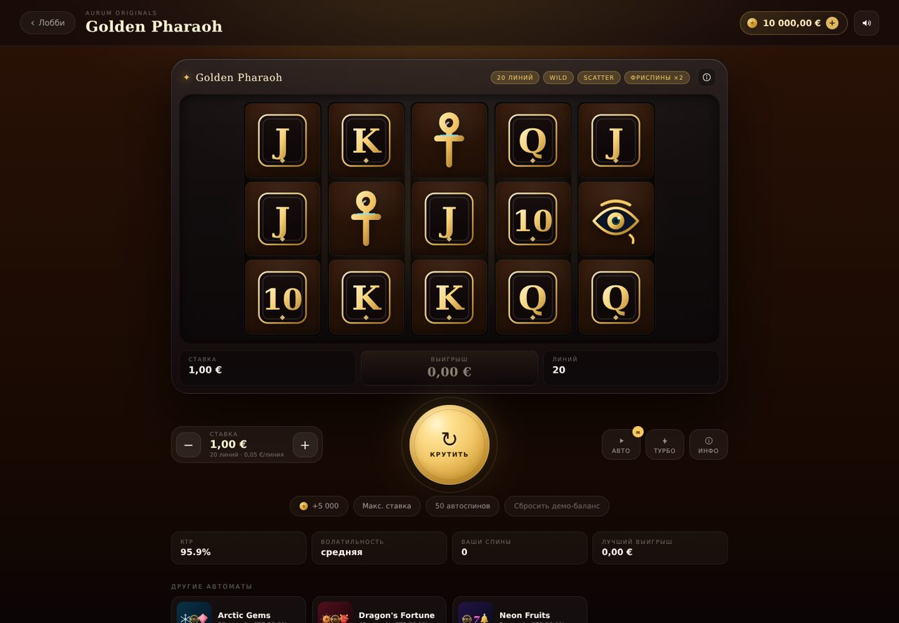

# AURUM — демо-казино со слотами

Играбельный сайт казино с четырьмя слотами на виртуальные кредиты. Настоящая математика: взвешенные барабаны,
линии выплат, Wild, Scatter, фриспины с множителями. Без регистрации, депозитов и реальных денег.


## Что внутри

| Автомат | Сетка | Линии | Особенности | RTP |
| --- | --- | --- | --- | --- |
| **Golden Pharaoh** | 5×3 | 20 | Scatter-скарабей, 10–20 фриспинов ×2 | 95,9% |
| **Arctic Gems** | 5×3 | 25 | Scatter-снежинка, 12–20 фриспинов ×2 | 95,9% |
| **Dragon's Fortune** | 5×4 | 40 | Scatter-печать, 10–20 фриспинов ×3 | 96,0% |
| **Neon Fruits** | 3×3 | 5 | Классика: только тройки и Wild | 96,0% |

Лобби с фильтрами и историей, кабинет автомата с барабанами, ставками, автоигрой и турбо-режимом,
таблица выплат со всеми линиями, звук на WebAudio, баланс и статистика в `localStorage`.



## Математика

Исход каждого спина определяется взвешенным ГСЧ на базе `crypto.getRandomValues`. Выплаты:
комбинация считается слева направо, Wild подставляет любой обычный символ, Scatter платит по общей ставке
и запускает фриспины (с ретриггерами).

RTP посчитан **аналитически**, а не «на глаз»: перебором всех последовательностей одной линии
(`src/game/math.ts`) плюс биномиальным распределением скаттеров и геометрической суммой фриспинов.
Проверка симуляцией на 1 000 000 спинов даёт те же значения в пределах статистической погрешности.

```bash
npm run sim     # Монте-Карло: RTP, hit rate, частота бонуса
npm run tune    # подбор «красивых» таблиц выплат под целевой RTP
```

Таблицы выплат подбирались автоматически: коэффициенты влияния каждой выплаты на RTP считаются точно,
затем значения округляются до целых с компенсацией, чтобы попасть в 96% ± 0,1 п.п.

## Стек

- **React 18 + TypeScript + Vite**
- Графика — SVG-иконки, нарисованные вручную (`src/components/SymbolIcon.tsx`), ноль внешних ассетов
- Звук — синтез через WebAudio (`src/game/sound.ts`)
- Состояние — хуки + `localStorage`, без стейт-менеджеров
- Адаптивная вёрстка, поддержка `prefers-reduced-motion`

```
src/
  game/
    types.ts          типы движка
    games.ts          описания автоматов, линии, таблицы выплат
    engine.ts         ГСЧ, генерация сетки, оценка линий и скаттеров
    math.ts           точный RTP (аналитика) и модель коэффициентов
    useSlotMachine.ts состояние спина, фриспины, автоигра
    wallet.ts         демо-баланс, статистика, форматирование
    sound.ts          синтезированные звуки
  components/         лобби, кабинет автомата, барабаны, таблица выплат
  styles.css          дизайн-система
```

## Запуск

```bash
npm install
npm run dev      # http://localhost:3000
npm run build    # продакшн-сборка в dist/
```

## Важно

Это демонстрационный проект: только виртуальные кредиты, реальные ставки и выплаты невозможны.
Игра создана, чтобы показать механику слотов и математику, а не для азартных игр. 18+.
